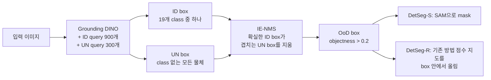
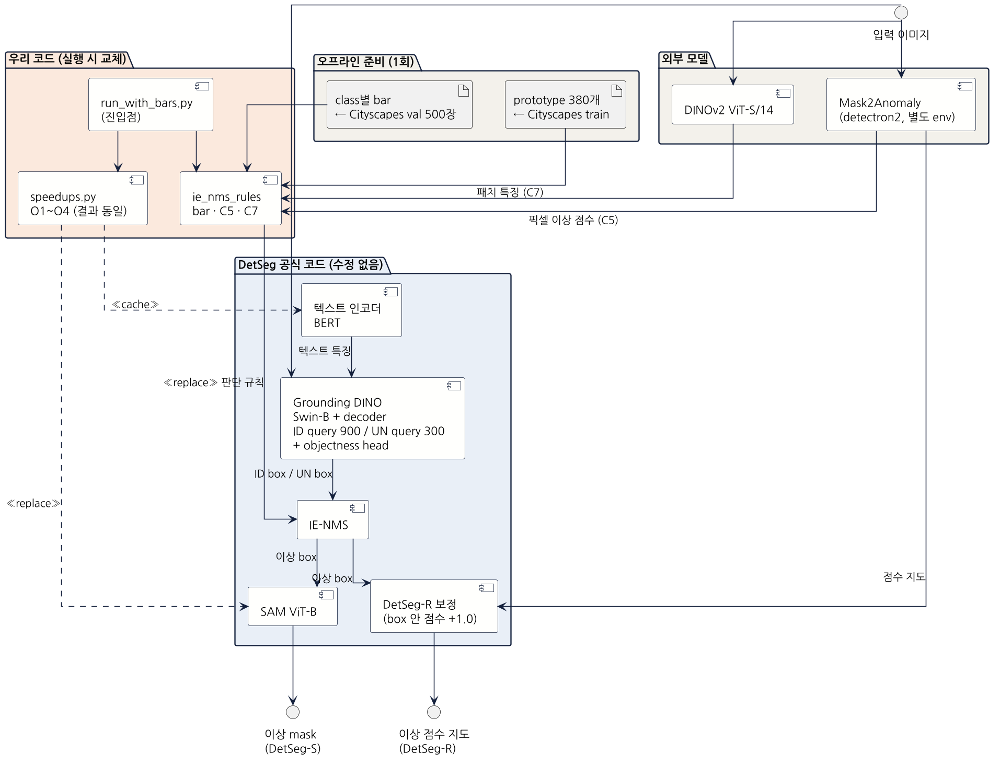
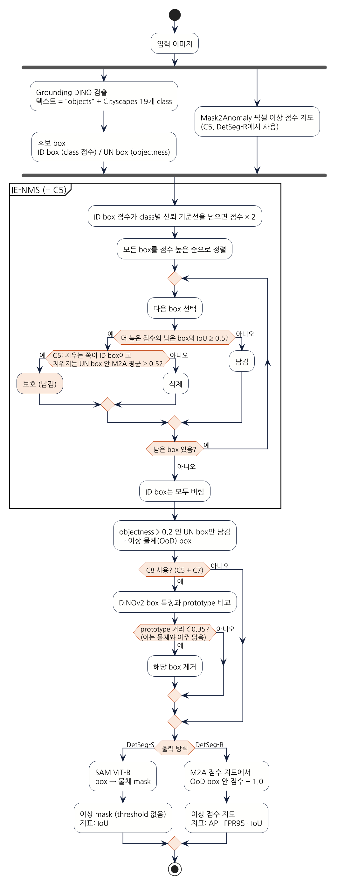
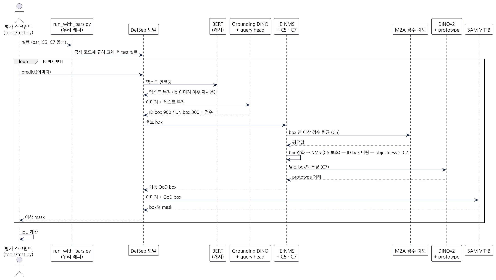
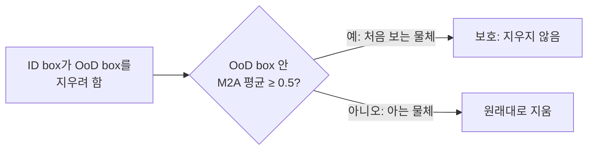
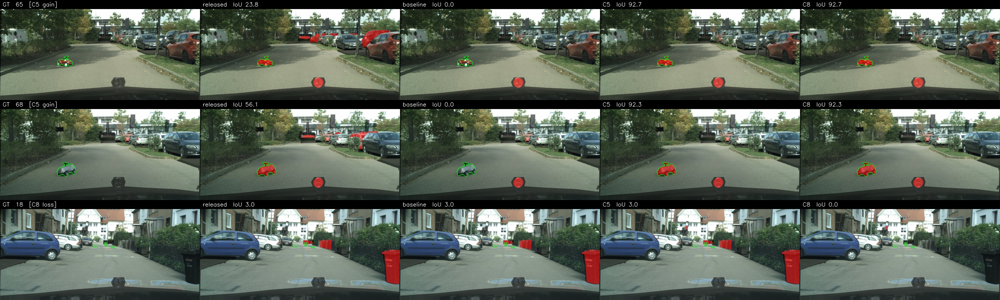
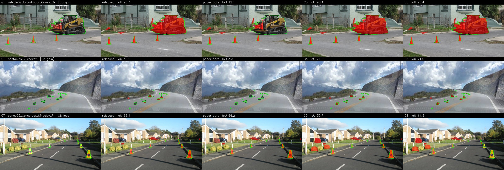
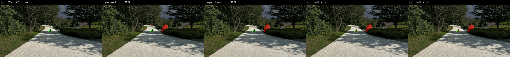
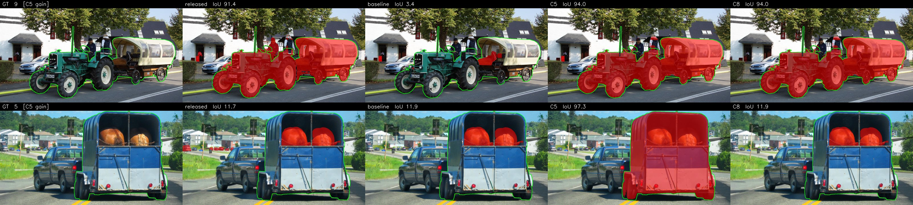

# 도로 장면 이상 물체 검출 DetSeg의 재현 분석과 재학습 없는 개선

> 졸업 프로젝트 보고서 초안 (2026-10-18)
> 대상 논문: Zhu et al., *Beyond Pixel Uncertainty: Bounding the OoD Objects in Road Scenes*, ICCV 2025
> 모든 수치의 근거: [09_results_summary.md](09_results_summary.md), 실험별 기록: [experiments/](experiments/)

---

## 요약

자율주행 차량은 학습 때 보지 못한 물체(떨어진 짐, 동물, 공사 장비 등)를 도로 위에서 찾아내야 한다. DetSeg(ICCV 2025)는 픽셀마다 이상 점수를 매기는 기존 방식 대신, 도로 위 모든 물체를 box로 찾은 뒤 "아는 물체"를 지우고 남은 box를 이상 물체로 보는 방법이다.

본 프로젝트는 먼저 공개된 코드와 가중치로 논문을 재현했다. Road Anomaly와 SMIYC에서는 논문과 비슷한 결과를 얻었지만, FS Lost & Found에서는 DetSeg-S IoU가 14.26으로 논문(32.36)의 절반에도 못 미쳤다. 같은 환경에서 기존 방법 Mask2Anomaly는 논문 수치를 소수 둘째 자리까지 재현했으므로, 차이는 데이터나 평가 방식이 아니라 DetSeg 공개본에 있었다. 분석 결과, 논문에 기술된 IE-NMS의 신뢰 기준선(논문 용어 bar) 보정 절차가 공개 코드에서 빠져 있었다. 이 절차를 복원하자 FS L&F는 24.26으로 회복됐지만, 진짜 이상 물체를 아는 물체로 오인해 지우는 문제가 커졌다(SMIYC Anomaly 69.12 → 54.57).

이를 해결하기 위해, 픽셀 분류기 Mask2Anomaly의 점수로 IE-NMS의 삭제 결정을 한 번 더 확인하는 규칙(C5)을 제안했다. 설정은 튜닝셋에서만 골랐고, 검증셋에서는 한 번만 평가했다. 그 결과 재학습 없이 SMIYC Obstacle 77.93 → 80.93, SMIYC Anomaly 54.57 → 78.06(공개본 69.12)으로 두 검증셋 모두 개선됐다. 다른 논문(PROWL)의 DINOv2 prototype 신호를 결합한 대안(C8)은 FS L&F에서 38.44까지 오르지만, 더 느리고 일부 이상 물체를 놓친다. 마지막으로 처리 시간을 분석해, 정확도를 전혀 바꾸지 않고 DetSeg-S를 최대 37% 빠르게 했다.

---

## 1. 서론

### 1.1 배경

도로 장면 이상 물체 분할(road anomaly segmentation)은 정해진 class(차, 사람, 도로 등, Cityscapes 19개)로 학습한 모델이 **처음 보는 물체**를 찾아내는 문제다. 기존 방법(Mask2Anomaly, RbA 등)은 segmentation 모델이 픽셀마다 얼마나 확신이 없는지를 이상 점수로 쓴다. 이 방식에는 두 가지 문제가 있다.

1. 물체 경계처럼 원래 애매한 곳에서 오탐이 생긴다
2. 점수를 이상/정상으로 나눌 threshold를 정해야 하고, 데이터마다 최적값이 다르다

### 1.2 대상 논문: DetSeg

DetSeg는 **물체 단위**로 접근한다. "도로 위 물체를 모두 찾고(detect all), 아는 물체를 지우면(suppress), 남은 것이 이상 물체"라는 발상이다. threshold를 고정값(0.2) 하나로 쓰고도 기존 방법과 비슷하거나 더 좋은 결과를 보고했다.

### 1.3 프로젝트 목표

1. **재현:** 공개 코드와 가중치로 논문 결과가 나오는지 확인한다
2. **분석:** 차이가 있다면 원인을 찾는다
3. **개선:** **재학습 없이** 성능을 올린다 (GPU 1장 환경, 학습 데이터·시간 제약)
4. **효율:** 처리 시간을 측정하고 줄인다

### 1.4 기여

1. 공개 코드에서 빠진 IE-NMS 신뢰 기준선 보정 절차를 찾아 논문 설명대로 복원했다 (FS L&F 14.26 → 24.26)
2. 실패를 이미지·box 단위로 추적해, 기준선 하나로는 "덜 지우는 문제"와 "너무 지우는 문제"를 함께 해결할 수 없음을 보였다
3. 재학습 없는 개선 규칙 C5를 제안하고, 미리 정한 튜닝·검증 절차로 두 검증셋 모두에서 개선을 확인했다
4. 다른 논문(PROWL)의 아이디어를 적용한 대안 C8을 만들고 성능과 시간의 trade-off를 정리했다
5. 결과를 바꾸지 않는 최적화로 DetSeg-S 처리 시간을 17~37% 줄였다

---

## 2. 배경: DetSeg의 동작

### 2.1 전체 흐름

| 구성 요소 | 출처 | 역할 |
|---|---|---|
| Grounding DINO (Swin-B) | 사전학습 open-vocabulary 검출기 | 텍스트("car", "person" …)로 물체를 찾음 |
| ID query | Grounding DINO 원래 query | 19개 아는 class 물체를 찾음 |
| UN query + objectness head | DetSeg가 추가, COCO로 학습 | class와 상관없이 "물체다운 것"을 모두 찾음 |
| IE-NMS | DetSeg | 아는 물체 자리의 UN box를 지움 |
| SAM (ViT-B) | 사전학습 분할 모델 | box를 받아 물체 mask를 만듦 |

### 2.2 IE-NMS (핵심 모듈)

1. ID box 중 점수가 **class별 기준선**을 넘는 것을 "확실히 아는 물체"로 보고 점수를 2배로 올린다
2. class 구분 없이 NMS(IoU 0.5)를 한다 → 강화된 ID box가 같은 자리의 UN box를 지운다
3. ID box를 모두 버린다
4. 남은 UN box 중 objectness > τ = 0.2인 것이 최종 이상 물체 box다

#### 신뢰 기준선이란? (논문·코드 용어: bar)

> **검출기가 "이건 내가 아는 물체(차, 사람 등)야"라고 말할 때, 그 말을 믿어 줄 최소 점수다.**
> 점수가 이 선을 넘은 ID box는 점수가 2배가 되어 우선권을 얻고, 같은 자리의 이상 물체 후보(UN box)를 지울 수 있게 된다.

- **class마다 하나씩** 있다 (19개). 보정 결과 예: 차 0.085, 사람 0.100, 트럭 0.114. 정답 물체 box가 있는 물체 class 8개만 보정할 수 있어서, 배경 class 11개(도로, 건물 등)는 공개값 0.2를 그대로 쓴다
- **선을 못 넘은 ID box도 사라지지 않는다.** 우선권(점수 2배)만 못 받을 뿐 NMS에는 그대로 참여한다
- **정하는 방법(논문):** Cityscapes에서 class마다, 정답을 맞힌 예측 box 중 **가장 낮은 점수**를 선으로 정한다. "이 점수로도 맞힌 적이 있으니 이 이상이면 믿을 만하다"는 뜻이다
- **공개 코드:** 이 보정 과정 없이 0.2(배경 class) / 0.5(물체 class)로 고정되어 있다

**예: 주차된 차 위에서 이상 물체 후보(UN box, 점수 0.35)와 "car" box(점수 0.26)가 겹친 경우**

| | car 신뢰 기준선 0.5 (공개 코드) | car 신뢰 기준선 0.085 (논문 방식) |
|---|---|---|
| car box가 선을 넘나? | 0.26 < 0.5 → 넘지 못함, 점수 0.26 그대로 | 0.26 > 0.085 → 넘음, 점수 **0.52** |
| 누가 먼저 처리되나 | UN box(0.35)가 먼저 → car box가 지워짐 | car box(0.52)가 먼저 → **UN box가 지워짐** |
| 결과 | 주차된 차가 이상 물체로 남음 (오탐) | 차로 올바르게 처리됨 |

선이 너무 높으면 아는 물체를 못 지우고(위의 왼쪽), 너무 낮으면 트럭처럼 생긴 이상 물체까지 "트럭"으로 믿고 지운다. 이 균형이 5장의 핵심 문제다.

> 용어 구분: **신뢰 기준선**(bar)은 IE-NMS 안의 값이고, **베이스라인**은 개선 효과를 비교하는 기준 실험(논문 방식 신뢰 기준선을 넣은 DetSeg)이다. 마지막 단계의 τ = 0.2는 이상 물체 후보를 최종으로 남길지 정하는 별개의 값이다.

### 2.3 두 가지 사용 방식

| | DetSeg-S | DetSeg-R |
|---|---|---|
| 하는 일 | box를 SAM에 넣어 이상 mask 생성 | 기존 방법(Mask2Anomaly)의 픽셀 점수를 box 안에서 올림 |
| threshold 탐색 | 필요 없음 | 필요 (평가 때 최적값 사용) |
| 지표 | IoU | AP, FPR95, 최적 threshold IoU |

### 2.4 시스템 설계 (UML)

본 프로젝트의 시스템(DetSeg 공식 코드 + 우리가 추가한 규칙)을 UML 다이어그램 세 개로 정리한다. 원본은 `docs/diagrams/*.puml`(PlantUML)이고, `conda run -n uml plantuml -tpng -o ../../assets/figures docs/diagrams/*.puml`로 다시 그릴 수 있다. 발표용 가로 3줄판 액티비티 다이어그램은 `docs/diagrams/activity_row{1,2,3}.dot`(Graphviz)이고, `conda run -n uml dot -Tpng -Gdpi=200 docs/diagrams/activity_row1.dot -o assets/figures/activity_row1.png`처럼 줄마다 그린다.

**(1) 컴포넌트 다이어그램: 시스템 구조**

| 패키지 | 구성 요소 | 비고 |
|---|---|---|
| DetSeg 공식 코드 | BERT, Grounding DINO(+ query head), IE-NMS, SAM, DetSeg-R 보정 | 파일 수정 없음 |
| 우리 코드 | `run_with_bars.py`(진입점), `ie_nms_rules`(기준선·C5·C7), `speedups.py`(O1~O4) | 실행 시점에 교체(monkeypatch). 옵션을 끄면 공식 결과와 동일함을 확인 |
| 외부 모델 | Mask2Anomaly(C5, DetSeg-R), DINOv2(C7) | Mask2Anomaly는 별도 환경에서 점수 지도를 미리 저장 |
| 오프라인 준비 | class별 기준선(Cityscapes val), prototype 380개(Cityscapes train) | 한 번만 계산 |

**(2) 액티비티 다이어그램: 이미지 한 장의 처리 흐름**

판단 지점(마름모)은 기준선 강화, NMS의 삭제 여부와 C5 보호, objectness 0.2 필터, C7 제거, 출력 방식(DetSeg-S/R) 다섯 곳이다.

**(3) 시퀀스 다이어그램: DetSeg-S + C8 실행 시 호출 순서**

텍스트 인코딩 → 검출 → IE-NMS(C5가 M2A 점수를, C7이 DINOv2 특징을 요청) → SAM 순서이며, 8장의 처리 시간 분석은 이 단계 구분을 따른다.

---

## 3. 실험 설정

### 3.1 환경

RTX 4070 Ti, WSL2, PyTorch 2.1.0 + CUDA 11.8. 공식 DetSeg 코드는 수정하지 않고, 바꿀 부분만 실행 시점에 교체(monkeypatch)했다.

### 3.2 데이터셋과 역할

| 데이터셋 | 장수 | 특징 | 역할 |
|---|---|---|---|
| FS Lost & Found | 100 | 도시 도로 위 작은 장애물 | **튜닝** |
| Road Anomaly | 60 | 인터넷 사진, 동물·돌·공사 장비 | **튜닝** |
| SMIYC Obstacle (val) | 30 | 도로 위 작은 물체 | **검증** |
| SMIYC Anomaly (val) | 10 | 크고 다양한 이상 물체 | **검증** |
| Cityscapes val | 500 | 정상 도로 장면 | 기준선 보정 |
| FS Static | 30 | 합성 | 데이터 버전 불일치로 비교 제외 |

### 3.3 공정한 개선 평가를 위한 규칙

개선 방법이 "검증셋에 맞춘 결과"가 되지 않도록 다음을 지켰다 ([05_improvement_plan.md](05_improvement_plan.md)).

1. 후보 설정값은 **실행 전에 문서로 등록**한다
2. 설정은 **튜닝셋(FS L&F + RA) 평균 IoU**로만 고른다
3. 검증셋(SMIYC 두 개)은 설정을 고정한 뒤 **한 번만** 평가한다
4. 성공 기준: 두 검증셋 모두 베이스라인보다 나빠지지 않고, 하나 이상 좋아질 것
5. 재학습 없음, 최종 threshold τ = 0.2 고정 (논문의 핵심 주장 유지)

---

## 4. 재현 결과

### 4.1 DetSeg-S (논문 Table 2, IoU)

| 데이터셋 | 논문 | 공개 코드 실행 | 판정 |
|---|---|---|---|
| Road Anomaly | 68.35 | 76.46 | 재현 (더 높음) |
| **FS L&F** | **32.36** | **14.26** | **불일치** |
| SMIYC Anomaly | 75.82 | 69.12 | 부분 재현 |
| SMIYC Obstacle | 81.58 | 77.93 | 부분 재현 |

### 4.2 환경 확인: 기존 방법 Mask2Anomaly

| 데이터셋 | AP 논문 / 우리 | FPR95 논문 / 우리 | IoU 논문 / 우리 |
|---|---|---|---|
| FS L&F | 69.46 / 69.44 | 9.31 / 9.31 | 34.35 / 34.33 |
| Road Anomaly | 79.70 / 82.05 | 13.45 / 15.73 | 58.43 / 58.41 |

같은 데이터와 같은 평가 코드에서 기존 방법은 논문과 일치한다. **따라서 FS L&F의 차이는 DetSeg 공개본 자체에서 나온 것이다.**

### 4.3 Ablation (논문 Table 6)

| | RA | FS L&F |
|---|---|---|
| Grounding DINO + "objects" | 53.82 | 2.72 |
| + UN query | 69.44 | 4.99 |
| + IE-NMS (전체) | 76.46 | 14.26 |

모듈을 더할수록 좋아지는 경향은 논문과 같다. IE-NMS의 효과가 가장 크므로 원인 분석은 IE-NMS에 집중했다.

---

## 5. 원인 분석

### 5.1 공개 코드와 논문의 차이

| 항목 | 논문 | 공개 코드 |
|---|---|---|
| IE-NMS 신뢰 기준선 | Cityscapes로 class마다 보정 | 0.2(배경 11개) / 0.5(물체 8개) 고정, **보정 코드 없음** |
| 가중치 | 논문 실험용 | 논문 이후 **재학습**한 것 (README 명시) |

재학습한 가중치는 점수 분포가 달라질 수 있으므로, 옛 가중치에 맞춘 기준선(0.5)이 새 가중치에는 맞지 않을 수 있다.

### 5.2 논문 방식 기준선 복원 ([A3](experiments/A3_ie_nms_bar_calibration.md))

Cityscapes val 500장에서 논문 설명대로 보정했더니 기준선이 **약 0.085~0.143**으로 나왔다 (공개 코드 0.5).

| | FS L&F | RA | SMIYC O | SMIYC A |
|---|---|---|---|---|
| 공개 코드 (기준선 0.5) | 14.26 | 76.46 | 77.93 | 69.12 |
| **논문 방식 기준선** (이후 베이스라인) | **24.26** | 79.25 | 77.93 | **54.57** |

FS L&F는 크게 회복됐지만 SMIYC Anomaly는 떨어졌다.

### 5.3 실패를 box 단위로 추적 ([A2](experiments/A2_failure_diagnosis.md))

| 실패 유형 | 내용 | 예 |
|---|---|---|
| 덜 지움 (기준선이 높을 때) | 주차된 차 위의 오탐 box가 남음. 그 차의 ID 점수(약 0.26)가 기준선 0.5를 못 넘음 | FS L&F |
| 너무 지움 (이상 물체가 ID box에 지워짐) | 진짜 이상 물체를 "truck"(0.57)·"road" box가 지움 | SMIYC Anomaly 이미지 5(말 트레일러), 이미지 4 |
| 작은 물체 | 후보 box 자체가 없거나 objectness < 0.2. IE-NMS 탓은 2% | FS L&F 멀리 있는 물체 |

**결론: 기준선을 낮추면 첫 번째가, 올리면 두 번째가 생긴다. 기준선 하나로는 두 실패를 함께 고칠 수 없다.** 문제의 핵심은 "이 box가 정말 아는 물체인가"를 Grounding DINO 하나에만 묻는다는 점이다.

---

## 6. 개선 방법

### 6.1 제안: C5 — Mask2Anomaly로 삭제를 한 번 더 확인

**아이디어:** Mask2Anomaly는 Cityscapes로 학습한 픽셀 분류기로, Grounding DINO와는 **다른 데이터와 다른 방식으로 배워서 다른 곳에서 틀린다.** 차·사람 픽셀에는 이상 점수를 낮게, 처음 보는 물체에는 높게 준다.

**규칙:** IE-NMS에서 ID box가 OoD box를 지우려 할 때, OoD box 안의 Mask2Anomaly 이상 점수 평균이 **0.5 이상이면 지우지 않는다.** 나머지(기준선, τ = 0.2, NMS)는 그대로다.

**근거 (튜닝셋에서 미리 확인):** IE-NMS가 지운 box 중 진짜 이상 물체의 M2A 점수 중앙값은 0.70, 오탐은 0.04였다. 구분력(AUC)은 FS L&F 0.946, RA 0.716이다.

**튜닝 (DetSeg-S IoU):**

| t | FS L&F | RA | 평균 |
|---|---|---|---|
| 베이스라인 | 24.26 | 79.25 | 51.76 |
| 0.3 | 33.73 | 70.01 | 51.87 |
| **0.5 (선택)** | 32.67 | 76.82 | **54.75** |
| 0.7 | 26.19 | 78.18 | 52.19 |

**DetSeg-R과의 관계:** DetSeg-R은 원래 Mask2Anomaly 점수 지도를 입력으로 쓰므로, C5에 추가 모델이 필요 없다.

### 6.2 대안: C8 = C5 + C7 (PROWL prototype 신호)

Finding Dino / PROWL(WACV)은 DINOv2 특징을 "아는 class의 대표 특징(prototype)"과 비교해 처음 보는 물체를 찾는다 ([08_prowl_analysis.md](08_prowl_analysis.md)). 우리는 Cityscapes train에서 class마다 20개, 모두 380개의 prototype을 만들었다.

- **C7:** IE-NMS 뒤 남은 OoD box 중 prototype과 아주 닮은 것(거리 < 0.35)을 지운다 → 남은 오탐 제거
- **C8:** C5(지우면 안 되는 것 보호) + C7(남은 오탐 제거)

### 6.3 시도했지만 채택하지 않은 후보

| 후보 | 결과 | 이유 |
|---|---|---|
| C1 배경 class box는 삭제 금지 | 기각 | 배경 box가 거대한 오탐 box를 지우는 역할을 하고 있었음 |
| C2 objectness 높으면 보호 | 기각 | objectness는 COCO로 학습되어 오히려 차·사람에서 가장 높음 |
| C3 도로 밖 box 점수 낮춤 | 효과 없음 | 기준선 보정이 도로 밖 오탐을 이미 제거 (297 → 38개) |
| C4 고해상도 입력 | 기각 | 학습 해상도 밖에서 box 예측이 무너짐 (FS L&F 24.26 → 0.32) |
| C6 PROWL 신호로 보호 | 기각 | RA의 아는 물체(인터넷 사진)가 Cityscapes prototype과 닮지 않아 오탐까지 보호 |

실패한 후보도 원인을 분석해 기록했다. 특히 C1·C2의 실패는 "IE-NMS의 각 부분이 실제로 어떤 역할을 하는가"를 보여주는 결과다.

---

## 7. 개선 결과

### 7.1 DetSeg-S (IoU, 주 결과)

| 방법 | FS L&F (튜닝) | RA (튜닝) | **SMIYC Obstacle (검증)** | **SMIYC Anomaly (검증)** |
|---|---|---|---|---|
| 논문 Table 2 | 32.36 | 68.35 | 81.58 | 75.82 |
| 공개 코드 | 14.26 | 76.46 | 77.93 | 69.12 |
| 베이스라인 (논문 방식 기준선) | 24.26 | **79.25** | 77.93 | 54.57 |
| **C5 (제안)** | 32.67 | 76.82 | 80.93 | **78.06** |
| C8 (대안) | **38.44** | 76.39 | **81.03** | 69.58 |

- **C5는 성공 기준을 충족한다.** 검증셋 두 곳 모두 베이스라인과 공개 코드보다 좋다
- FS L&F는 공개 코드 14.26에서 논문 수치(32.36) 수준까지 올라왔다
- RA는 베이스라인보다 2.43 낮다 (§7.4)

### 7.2 DetSeg-R (Mask2Anomaly + DetSeg-R): AP / FPR95 / 최적 IoU

| 데이터셋 | M2A 단독 | 공개 코드 | 베이스라인 | **C5** | C8 |
|---|---|---|---|---|---|
| FS L&F | 69.44 / 9.31 / 34.33 | 70.84 / 9.39 / 31.15 | 73.19 / 8.09 / 29.15 | 77.59 / 6.64 / 36.43 | **83.15 / 6.17 / 37.71** |
| RA | 82.05 / 15.73 / 58.41 | **88.27** / 8.92 / **70.18** | 87.97 / 9.40 / 68.77 | 87.32 / **8.87** / 67.03 | 87.13 / 9.28 / 66.05 |
| SMIYC O | 92.83 / 0.16 / 67.17 | 97.86 / 0.04 / 72.42 | 97.86 / 0.04 / 72.42 | **98.24 / 0.03** / 75.44 | **98.24 / 0.03 / 75.50** |
| SMIYC A | **95.49 / 2.39 / 84.37** | 81.98 / 12.71 / 71.15 | 69.56 / 10.44 / 58.29 | 91.63 / 12.60 / 79.17 | 82.10 / 12.59 / 71.13 |

- C5는 DetSeg-R에서도 검증셋 두 곳의 AP와 IoU를 올린다 (SMIYC Anomaly AP 69.56 → 91.63)
- FS L&F에서 DetSeg-R이 처음으로 M2A 단독보다 모든 지표가 좋아졌다
- 단, SMIYC Anomaly에서는 여전히 M2A 단독보다 낮다. box 안의 배경까지 점수가 올라가는 DetSeg-R의 구조적 한계로, 논문도 이를 인정한다

### 7.3 정성 결과 ([F1](experiments/F1_qualitative.md))

이미지는 직접 고르지 않고 규칙으로 선택했다 (C5 이득 상위 2장 + C8 손해 1장). 빨강은 예측, 초록 선은 정답, 어두운 영역은 평가에서 제외되는 부분이다.

| 장면 | 베이스라인 → C5 | 설명 |
|---|---|---|
| RA 스키드로더 | 12.1 → 90.4 | 공사 차량을 "truck" box가 지우던 것을 보호 |
| SMIYC A 트랙터·마차 | 3.4 → 94.0 | 아는 물체(ID) box의 삭제를 막음 |
| SMIYC A 말 트레일러 | 11.9 → 97.3 | 트레일러 전체 box를 보호 |
| FS L&F 장난감 차 | 0.0 → 92.7 | "car"로 오인되어 지워지던 작은 물체 |

### 7.4 이미지별 변화와 부작용

| 데이터셋 | C5가 좋아진 장수 | C5가 나빠진 장수 | C8이 C5보다 좋은 장수 | 나쁜 장수 |
|---|---|---|---|---|
| FS L&F (100) | 11 | 4 | 29 | 1 |
| RA (60) | 4 | **18** | 7 | 5 |
| SMIYC O (30) | 1 | 0 | 1 | 0 |
| SMIYC A (10) | 3 | 1 | 0 | 1 |

(1 IoU점 넘게 바뀐 이미지 수)

- **C5의 부작용:** RA에서는 Mask2Anomaly가 인터넷 사진 속 덤불·차량에도 높은 점수를 줘서 오탐까지 보호된다 (예: cones05 66.2 → 35.7)
- **C8의 부작용:** C7은 콘이나 트레일러처럼 "아는 물체와 닮은" 이상 물체를 지운다. SMIYC Anomaly에서 C8이 C5보다 8.5 낮은 것은 거의 말 트레일러 이미지 한 장(97.3 → 11.9) 때문이다

---

## 8. 처리 시간

### 8.1 측정 규칙

30장(5장 워밍업 후), 3회 반복 평균, batch 1, 단계마다 GPU 동기화, 다른 GPU 작업 없음. 같은 규칙을 모든 비교에 적용했다 ([T2](experiments/T2_latency_baseline.md)).

### 8.2 어디서 시간이 드는가 ([T1](experiments/T1_latency_profile.md))

DetSeg-S(공개 코드, FS L&F) 808 ms 중 **SAM이 54%** 였고, 그 대부분은 GPU 계산이 아니라 **CPU 전·후처리**였다. 공식 코드는 box마다 mask 3장을 CPU에서 원본 크기로 키운 뒤 1장만 썼고, 같은 이미지를 전처리기에 두 번 넣었다. DetSeg-R의 DetSeg 부분은 227 ms로 논문(225 ms)과 같았다.

### 8.3 결과를 바꾸지 않는 최적화 ([T3](experiments/T3_speedups.md))

| 최적화 | 내용 |
|---|---|
| O1 SAM 후처리 | 실제로 쓰는 mask 1장만, GPU에서 같은 보간 |
| O2 SAM 전처리 | 이미지 1번만 처리 |
| O3 텍스트 인코더 | 매번 같은 문장 → 한 번 계산 후 재사용 |
| O4 규칙 계산 | IoU 행렬을 한 번에 계산 |

**12개 실행(3개 파이프라인 × 4개 데이터셋)에서 모든 정확도 지표가 소수 둘째 자리까지 같음을 확인했다.**

| 방법 (ms/이미지) | FS L&F | RA | SMIYC O | SMIYC A |
|---|---|---|---|---|
| DetSeg-S (공개 코드) | 808 → **532** (−34%) | 679 → **433** (−36%) | 655 → **545** (−17%) | 654 → **414** (−37%) |
| DetSeg-S + C5 | 1,189 → 1,040 (−13%) | 1,068 → 852 (−20%) | 1,192 → 1,068 (−10%) | 1,043 → 796 (−24%) |
| DetSeg-S + C8 | 1,336 → 1,106 (−17%) | 1,178 → 901 (−23%) | 1,373 → 1,134 (−17%) | 1,148 → 852 (−26%) |
| M2A + DetSeg-R + C5 | 857 → 817 (−5%) | 691 → 660 (−5%) | 853 → 819 (−4%) | 667 → 635 (−5%) |

- C5는 DetSeg-S에 Mask2Anomaly(약 400~500 ms)를 추가로 돌려야 해서 느리다. 최적화된 공개 코드보다 약 0.4~0.5초 더 걸린다
- DetSeg-R에서는 Mask2Anomaly가 원래 필요하므로 C5의 추가 비용이 약 15~45 ms뿐이다
- C8은 DINOv2가 더해져 가장 느리다

### 8.4 방법 선택 가이드

| 상황 | 추천 |
|---|---|
| 기존 방법(Mask2Anomaly)을 이미 쓰고 있음 | **DetSeg-R + C5**: 추가 비용이 거의 없고 검증셋 두 곳 모두 개선 |
| threshold 없는 mask가 필요함 | **DetSeg-S + C5**: 약 0.8~1.1초 |
| 도시 도로의 작은 장애물이 중요하고 시간 여유가 있음 | **C8**: FS L&F 최고 성능, 가장 느림, 아는 물체를 닮은 큰 이상 물체는 놓칠 수 있음 |

---

## 9. 한계

1. **검증셋이 작다.** SMIYC Obstacle 30장, Anomaly 10장이다. Obstacle의 +3.0은 이미지 1장에서 나왔다
2. **원래 가중치를 확인할 수 없다.** 논문 실험용 가중치가 공개되지 않아, "원래 가중치 + 원래 기준선"의 결과는 알 수 없다. 그래서 논문 수치와의 비교는 참고로만 쓰고, 개선은 같은 환경의 베이스라인과 비교했다
3. **아이디어의 출처.** C5·C7은 검증셋의 실패 사례(SMIYC Anomaly)를 분석한 뒤 떠올렸다. 다만 설정값은 튜닝셋에서만 골랐다
4. **C5는 DetSeg-S 단독이 아니다.** Mask2Anomaly를 함께 쓰므로 처리 시간이 늘어난다
5. **RA에서는 C5가 베이스라인보다 낮다** (79.25 → 76.82). Mask2Anomaly가 Cityscapes와 다른 장면(인터넷 사진)에서 정상 물체에도 높은 점수를 주기 때문이다
6. **작은 물체 문제는 남아 있다.** 손실의 대부분은 IE-NMS 이전 단계(후보 없음, 낮은 objectness)에서 생긴다
7. **범위 밖:** FS Static(데이터 버전 불일치), SMIYC test 서버, 비디오 모듈 VPHM(공개 코드에 미구현)

## 10. 향후 연구

1. 작은 물체: 후보 생성 단계 개선 (예: 이미지 일부를 확대해 다시 검출하는 tiling)
2. 속도: fp16, Mask2Anomaly 좌우반전 생략 (결과가 조금 바뀔 수 있어 별도 검증 필요)
3. 장면 적응: Mask2Anomaly 점수를 장면 종류에 따라 보정해 RA 같은 장면의 부작용 감소
4. 더 큰 검증: SMIYC test 서버 제출

## 11. 결론

공개된 DetSeg를 그대로 실행하면 일부 데이터셋에서 논문 성능이 나오지 않았고, 그 원인은 논문에는 있지만 코드에는 없는 IE-NMS 신뢰 기준선 보정이었다. 이를 복원하자 성능이 일부 회복됐지만, "아는 물체인가"를 검출기 하나에만 묻는 구조 때문에 진짜 이상 물체를 지우는 문제가 드러났다. 본 프로젝트는 다른 방식으로 학습된 픽셀 분류기에게 한 번 더 확인하는 규칙(C5)으로 이 문제를 줄였다. 재학습 없이, 미리 정한 절차에 따라 두 검증셋 모두에서 개선을 확인했다. 또한 정확도를 바꾸지 않고 처리 시간을 최대 37% 줄였다.

---

## 부록 A. 재현 방법

| 항목 | 위치 |
|---|---|
| 환경·데이터 준비 | [03_environment_and_data.md](03_environment_and_data.md) |
| 코드 구조 설명 | [04_code_walkthrough.md](04_code_walkthrough.md), [07_full_pipeline_explained.md](07_full_pipeline_explained.md) |
| 이미지 한 장의 판단 과정 | [06_decision_logic.md](06_decision_logic.md) |
| 개선 사전 등록 | [05_improvement_plan.md](05_improvement_plan.md) |
| 실행 진입점 | `src/run_with_bars.py` (기준선, C5, C7, `--fast`, `--save-masks`) |
| 처리 시간 측정 | `scripts/latency_baseline.sh`, `src/profile_latency.py` |
| 그림 | `scripts/save_masks_for_figures.sh`, `src/make_qualitative.py` |

## 부록 B. 실험 목록

[experiments/README.md](experiments/README.md): E1~E4(재현), A2·A3(분석), I1~I6(개선), P1(PROWL 사전 분석), T1~T3(시간), F1(정성 결과)
