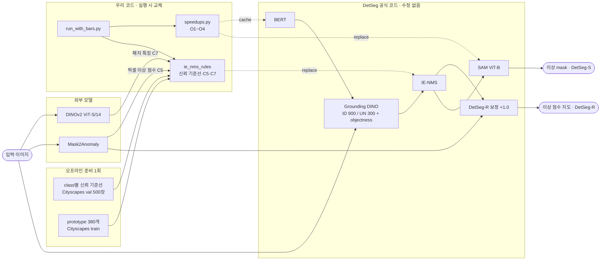
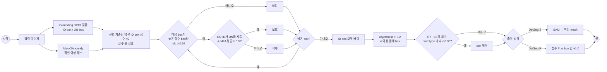
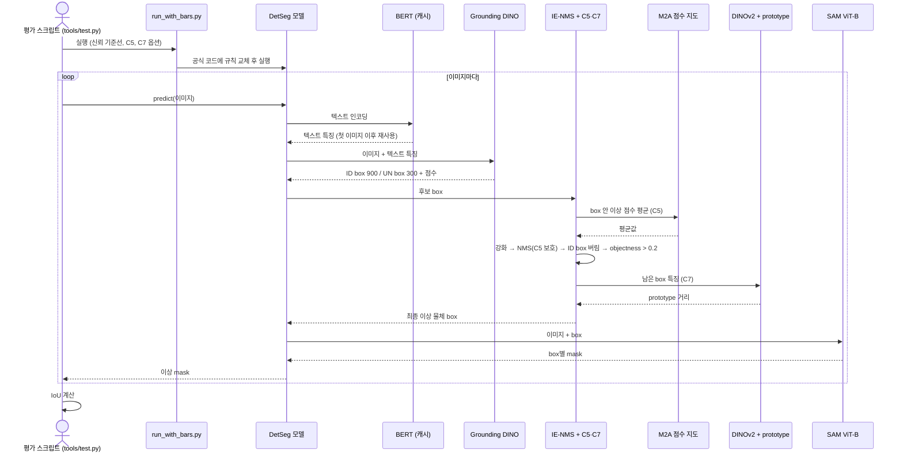

# 발표자료 제작용 프로젝트 정리 (단일 파일)

> 이 파일 하나만 보고 발표자료를 만들 수 있도록, 프로젝트의 결론·시스템 구조·처리 흐름·전체 실험·수치·그림 목록·주의할 표현을 모두 담았다.
> 모든 수치는 실제 실험 결과다. 수치를 바꾸거나 반올림 방식을 바꾸지 말 것. 그림 파일은 13절 목록을 따로 첨부한다.
> 작성: 2026-10-18 · 근거 문서: `docs/09_results_summary.md`, `docs/10_report_draft.md`, `docs/experiments/*.md`

---

## 0. 발표 제목과 한 문장 결론

- **제목 (안):** 도로 위 처음 보는 물체 찾기: DetSeg 재현과 재학습 없는 개선
- **대상 논문:** Zhu et al., *Beyond Pixel Uncertainty: Bounding the OoD Objects in Road Scenes*, ICCV 2025 (코드: github.com/huachao0124/DetSeg-official)
- **한 문장 결론:** 공개 코드로는 논문 성능이 재현되지 않았고, 원인(논문에 있는 신뢰 기준선 보정이 코드에 없음)을 찾아 복원한 뒤, 그 과정에서 드러난 구조적 문제를 **재학습 없이** 고치는 규칙 C5를 제안해 **미리 떼어 둔 검증셋 두 곳 모두에서 개선**했다. 또 정확도를 전혀 바꾸지 않고 처리 시간을 최대 37% 줄였다.

**핵심 숫자 3개 (표지 다음 장에 쓰기 좋음)**

| 숫자 | 의미 |
|---|---|
| FS L&F IoU **14.26 → 32.67** | 공개 코드가 논문(32.36)의 절반이던 것을 논문 수준으로 회복 |
| SMIYC Anomaly IoU **54.57 → 78.06** (검증셋) | 베이스라인 대비. 공개 코드 69.12보다도 높음. 검증셋 두 곳 모두 개선 |
| DetSeg-S 처리 시간 **808 → 532 ms (−34%)** | 정확도 지표는 소수 둘째 자리까지 동일 |

---

## 1. 용어 (발표에서 쓰는 쉬운 말)

| 발표 용어 | 원래 용어 | 뜻 |
|---|---|---|
| 이상 물체 | OoD (Out-of-Distribution) object | 학습 때 본 19개 class(차, 사람, 도로 등)에 없는 물체: 떨어진 짐, 동물, 공사 장비 등 |
| 아는 물체 | ID (In-Distribution) | Cityscapes 19개 class |
| ID box | ID query가 낸 box | "이건 차다"처럼 class가 붙은 box (점수 = class 점수) |
| UN box (이상 물체 후보) | universal query가 낸 box | class 없이 "물체다운 것"을 모두 찾은 box (점수 = objectness) |
| **신뢰 기준선** | IE-NMS **bar** | 검출기가 "이건 아는 물체야"라고 할 때 그 말을 믿어 줄 최소 점수. class마다 하나 (19개). 넘으면 ID box 점수가 2배가 되어 우선권을 얻음 |
| **베이스라인** | baseline | 개선 효과를 비교하는 기준 실험 = 논문 방식으로 보정한 신뢰 기준선을 넣은 DetSeg |
| τ = 0.2 | objectness threshold | UN box를 최종 이상 물체로 남길지 정하는 고정값 (신뢰 기준선과 다른 값) |
| 튜닝셋 / 검증셋 | tuning / held-out validation | 설정을 고르는 데이터 / 설정 고정 후 한 번만 평가하는 데이터 |
| M2A | Mask2Anomaly | 기존 픽셀 단위 이상 탐지 방법 (Cityscapes로 학습한 segmentation 모델) |

---

## 2. 배경: 문제와 DetSeg

### 2.1 문제
- 자율주행 차량은 학습 때 못 본 물체를 도로에서 찾아야 한다
- 기존 방법(Mask2Anomaly, RbA 등)은 픽셀마다 "얼마나 확신이 없는지"를 이상 점수로 쓴다
  - 물체 경계처럼 애매한 곳에서 오탐
  - 이상/정상을 가르는 threshold를 데이터마다 다시 골라야 함

### 2.2 DetSeg의 아이디어 (논문)
**"모두 찾고(detect all), 아는 것을 지우면(suppress), 남은 것이 이상 물체"** · threshold 0.2 하나로 고정

1. **모든 물체 찾기:** Grounding DINO(Swin-B, 텍스트로 찾을 대상을 지정하는 검출기). 텍스트 = "objects" + Cityscapes 19개 class 이름. ID query 900개 + UN query 300개 + objectness head
2. **아는 물체 지우기 (IE-NMS):** 신뢰 기준선을 넘은 ID box의 점수를 2배로 → class 구분 없이 NMS(IoU 0.5) → 강화된 ID box가 같은 자리의 UN box를 지움 → ID box는 모두 버림
3. **남은 것 = 이상 물체:** objectness > 0.2인 UN box
4. **결과 만들기:**
   - **DetSeg-S:** box를 SAM(ViT-B)에 넣어 이상 mask 생성 (threshold 탐색 없음, 지표 IoU)
   - **DetSeg-R:** 기존 방법(M2A)의 픽셀 점수 지도를 box 안에서 +1.0 (지표 AP, FPR95, 최적 threshold IoU)

### 2.3 신뢰 기준선 예시 (발표에서 설명하기 좋은 예)

주차된 차 위에서 UN box(objectness 0.35)와 "car" ID box(점수 0.26)가 겹친 경우:

| | car 신뢰 기준선 0.5 (공개 코드) | car 신뢰 기준선 0.085 (논문 방식 보정) |
|---|---|---|
| car box가 선을 넘나? | 0.26 < 0.5 → 그대로 0.26 | 0.26 > 0.085 → **0.52** |
| NMS 순서 | UN box(0.35)가 먼저 → car box가 지워짐 | car box(0.52)가 먼저 → **UN box가 지워짐** |
| 결과 | 주차된 차가 이상 물체로 남음 (오탐) | 차로 올바르게 처리 |

- 선을 못 넘은 ID box도 NMS에는 참여한다 (우선권만 못 받음)
- 논문 보정 방법: Cityscapes에서 class마다, 정답을 맞힌 예측 box 중 **가장 낮은 점수**를 선으로
- 선이 높으면 아는 물체를 덜 지우고(오탐 남음), 낮으면 트럭처럼 생긴 이상 물체까지 지움

---

## 3. 시스템 아키텍처 (UML 컴포넌트 다이어그램 내용)

### 3.1 구성 요소

| 패키지 | 구성 요소 | 역할 | 비고 |
|---|---|---|---|
| **DetSeg 공식 코드** (수정 없음) | 텍스트 인코더 BERT | class 이름 → 텍스트 특징 | |
| | Grounding DINO (Swin-B + decoder, ID 900 / UN 300 query, objectness head) | box 후보 생성 | 공개 가중치 그대로 |
| | IE-NMS | 아는 물체 자리의 UN box 삭제 | 우리 규칙으로 교체되는 지점 |
| | SAM ViT-B | box → mask (DetSeg-S) | |
| | DetSeg-R 보정 | 점수 지도에서 box 안 +1.0 | |
| **우리 코드** (실행 시점에 교체, monkeypatch) | `run_with_bars.py` | 진입점. 옵션(신뢰 기준선, C5, C7, `--fast`)을 받아 공식 평가 스크립트 실행 | 옵션을 끄면 공식 결과와 동일함을 확인 |
| | `ie_nms_rules` | 신뢰 기준선 · C5 · C7 판단 규칙 | |
| | `speedups.py` | 속도 최적화 O1~O4 (결과 동일) | |
| **외부 모델** | Mask2Anomaly (detectron2, 별도 conda 환경) | 픽셀 이상 점수 지도 (C5, DetSeg-R) | 점수 지도를 .npy로 저장해 공유 |
| | DINOv2 ViT-S/14 | 패치 특징 (C7) | |
| **오프라인 준비** (한 번만) | class별 신뢰 기준선 | Cityscapes val 500장으로 보정 | `calibrate_ie_nms_bars.py` |
| | prototype 380개 | Cityscapes train에서 class당 20개 | `prowl_bank.py` |

### 3.2 구조도 (Mermaid)

---

## 4. 처리 흐름 (UML 액티비티 다이어그램 내용)

### 4.1 단계 (이미지 한 장)
1. 입력 이미지
2. **병렬:** (a) Grounding DINO 검출 → ID box / UN box 후보, (b) Mask2Anomaly 픽셀 이상 점수 지도
3. **IE-NMS 시작:** 신뢰 기준선을 넘은 ID box 점수 × 2, 모든 box를 점수 순 정렬
4. **IE-NMS 반복 (+ C5):** 다음 box가 더 높은 점수 box와 IoU ≥ 0.5로 겹치면
   - **C5 판단:** 지우는 쪽이 ID box이고 지워지는 UN box 안의 M2A 이상 점수 평균 ≥ 0.5 → **보호(남김)**
   - 아니면 삭제
   - 안 겹치면 남김. 남은 box가 없을 때까지 반복
5. ID box는 모두 버림
6. objectness > 0.2인 UN box = 이상 물체 box
7. **C7 (C8일 때만):** DINOv2 box 특징과 prototype의 거리 < 0.35 (아는 물체와 아주 닮음)면 그 box 제거
8. **출력:** DetSeg-S → SAM으로 mask (지표 IoU) / DetSeg-R → M2A 점수 지도에서 box 안 +1.0 (지표 AP·FPR95·IoU)

### 4.2 흐름도 (Mermaid)

## 5. 실행 순서 (UML 시퀀스 다이어그램 내용, DetSeg-S + C8)

---

## 6. 실험 설계

### 6.1 환경
- RTX 4070 Ti, WSL2, PyTorch 2.1.0 + CUDA 11.8 (DetSeg: mmdet 3.3.0 / M2A: detectron2 0.6, 별도 환경)
- 공개 가중치 `detseg_swin-b_coco_20260623` 그대로 사용. **재학습 없음**
- 공식 코드 파일은 수정하지 않고 실행 시점에만 교체

### 6.2 데이터셋과 역할

| 데이터셋 | 장수 | 특징 | 역할 |
|---|---|---|---|
| FS Lost & Found | 100 | 도시 도로의 작은 장애물 | 튜닝 |
| Road Anomaly (RA) | 60 | 인터넷 사진, 동물·돌·공사 장비 | 튜닝 |
| SMIYC Obstacle val | 30 | 도로 위 작은 물체 | **검증** |
| SMIYC Anomaly val | 10 | 크고 다양한 이상 물체 | **검증** |
| Cityscapes val | 500 | 정상 도로 장면 | 신뢰 기준선 보정 |
| Cityscapes train | (133장 사용) | 정상 도로 장면 | prototype 생성 (C7) |
| FS Static | 30 | 합성 | 데이터 버전 불일치로 비교 제외 |

논문 Table 2도 SMIYC는 val로 평가했다 (같은 split).

### 6.3 공정성 규칙 (개선 실험)
1. 후보 설정값은 **실행 전에 문서로 등록**
2. 설정은 **튜닝셋(FS L&F + RA) 평균 IoU**로만 선택
3. 검증셋(SMIYC 두 개)은 설정 고정 후 **한 번만** 평가
4. 성공 기준: 검증셋 두 곳 모두 베이스라인보다 나빠지지 않고, 하나 이상 좋아질 것
5. 재학습 없음, τ = 0.2 고정 (논문의 핵심 주장 유지)

### 6.4 지표
- **IoU:** 예측 mask와 정답의 겹침 비율 (평가 제외 영역 void는 무시)
- **AP:** 점수 지도가 이상 픽셀을 얼마나 위로 올리는지 (높을수록 좋음)
- **FPR95:** 이상 픽셀 95%를 찾을 때 정상 픽셀을 잘못 잡는 비율 (낮을수록 좋음)
- **최적 IoU:** 점수 지도 방식은 threshold를 0.01 간격으로 바꿔 IoU가 가장 높은 값 사용 (논문과 같은 방식)

---

## 7. 전체 실험 목록 (흐름 순)

| 단계 | ID | 실험 | 결과 한 줄 |
|---|---|---|---|
| 재현 | E1 | DetSeg-S 재현 (논문 Table 2) | RA·SMIYC 부분 재현, **FS L&F 14.26 (논문 32.36) 불일치** |
| 재현 | E2 | 기존 방법 M2A 단독 | 논문과 소수 둘째 자리까지 일치 → 환경·평가는 정상 |
| 재현 | E3 | M2A + DetSeg-R | RA·Obstacle 개선 재현, FS L&F·SMIYC Anomaly 실패 |
| 재현 | E4 | Ablation (논문 Table 6) | 논문과 같은 경향, IE-NMS 효과가 가장 큼 |
| 분석 | A2 | 실패 진단 (box 단위 추적) | 덜 지움(차 위 오탐) + 너무 지움(이상 물체를 "truck" box가 삭제) |
| 분석 | A3 | 신뢰 기준선 논문 방식 보정 | 0.5 → 약 0.085~0.143. FS L&F 24.26 회복, SMIYC A 54.57 하락 → **베이스라인** |
| 개선 | I1 | C1 배경 box 삭제 금지 / C2 objectness 높으면 보호 | 둘 다 기각 (튜닝 크게 악화) |
| 개선 | I2 | C3 도로 밖 box 점수 낮춤 | 효과 없음 (튜닝 +0.54, 검증 변화 없음) |
| 개선 | I3 | C4 고해상도 입력 | 기각 (1.5배에서 FS L&F 0.32) |
| 개선 | **I4** | **C5 M2A로 삭제 확인** | **성공**: 검증 SMIYC O 77.93 → 80.93, SMIYC A 54.57 → 78.06 |
| 개선 | P1 | PROWL 신호 사전 분석 | DINOv2 prototype 신호가 지운 후보 구분 AUC FS 0.985 / RA 0.794 |
| 개선 | I5 | C6 PROWL로 보호 / C7 PROWL로 제거 | C6 기각, C7은 튜닝셋에만 효과 (검증 +0.1) |
| 개선 | I6 | C8 = C5 + C7 | FS L&F 최고 38.44, SMIYC A는 C5보다 낮음, 가장 느림 → **대안** |
| 시간 | T1 | 처리 시간 분석 | DetSeg-S 808 ms 중 SAM 54% (대부분 CPU 작업) |
| 시간 | T2 | 처리 시간 베이스라인 고정 | 같은 측정 규칙으로 모든 방법 측정 |
| 시간 | T3 | 결과를 바꾸지 않는 최적화 | DetSeg-S 17~37% 단축, 12개 실행 정확도 동일 |
| 정리 | F1 | 정성 결과 그림, 이미지별 IoU | 규칙 기반 자동 선택, 성공·부작용 사례 |

---

## 8. 실험별 상세 결과

### 8.1 재현 (E1~E4)

**E1. DetSeg-S IoU (논문 Table 2)**

| 데이터셋 | 논문 | 공개 코드 실행 | 판정 |
|---|---|---|---|
| Road Anomaly | 68.35 | 76.46 | 재현 (더 높음) |
| FS L&F | 32.36 | **14.26** | **불일치** |
| SMIYC Anomaly | 75.82 | 69.12 | 부분 재현 |
| SMIYC Obstacle | 81.58 | 77.93 | 부분 재현 |
| FS Static | 83.34 | 33.51 | 비교 불가 (우리 데이터 버전은 30장 중 10장에 이상 물체가 없어 최대 66.7) |

**E2. M2A 단독 (환경 확인)**

| 데이터셋 | AP 논문 / 우리 | FPR95 논문 / 우리 | IoU 논문 / 우리 |
|---|---|---|---|
| FS L&F | 69.46 / 69.44 | 9.31 / 9.31 | 34.35 / 34.33 |
| Road Anomaly | 79.70 / 82.05 | 13.45 / 15.73 | 58.43 / 58.41 |
| SMIYC Anomaly | – | – | 83.74 / 84.37 |
| SMIYC Obstacle | – | – | 67.13 / 67.17 |

→ 데이터와 평가 코드는 논문과 같다. **차이는 DetSeg 공개본에 있다.**

**E3. M2A + DetSeg-R (개선폭, 논문 / 우리)**

| 데이터셋 | AP 개선폭 | IoU 개선폭 |
|---|---|---|
| Road Anomaly | +7.87 / +6.22 | +6.84 / +11.77 |
| SMIYC Obstacle | – | +5.70 / +5.25 |
| FS L&F | +8.69 / **+1.40** | +1.11 / **−3.18** |
| SMIYC Anomaly | – | −1.23 / **−13.22** |

**E4. Ablation (DetSeg-S IoU, 논문 Table 6 대응)**

| | RA | FS L&F | SMIYC A | SMIYC O |
|---|---|---|---|---|
| Grounding DINO + "objects" | 53.82 | 2.72 | 85.62 | 39.15 |
| + UN query (IE-NMS 없음) | 69.44 | 4.99 | 75.06 | 77.93 |
| + IE-NMS (전체) | 76.46 | 14.26 | 69.12 | 77.93 |

### 8.2 원인 분석 (A2, A3)

**공개 코드와 논문의 차이**

| 항목 | 논문 | 공개 코드 |
|---|---|---|
| 신뢰 기준선 | Cityscapes로 class마다 보정 | 0.2(배경 11개) / 0.5(물체 8개) 고정, 보정 코드 없음 |
| 가중치 | 논문 실험용 | 논문 약 9개월 뒤 재학습 (README 명시) |

**A3. 논문 방식 보정 결과 (Cityscapes val 500장):** car 0.085, bicycle 0.085, rider 0.100, person 0.100, motorcycle 0.112, truck 0.114, bus 0.116, train 0.143. 배경 11개 class는 정답 물체 box가 없어 공개값 0.2 유지

| DetSeg-S IoU | FS L&F | RA | SMIYC O | SMIYC A |
|---|---|---|---|---|
| 공개 코드 (기준선 0.5) | 14.26 | 76.46 | 77.93 | 69.12 |
| 논문 방식 신뢰 기준선 (= 베이스라인) | **24.26** | 79.25 | 77.93 | **54.57** |

**A2. 실패 유형 (box 단위 추적)**

| 유형 | 내용 |
|---|---|
| 덜 지움 (선이 높을 때) | FS L&F 오탐 후보의 41%가 IE-NMS 뒤 남음. 대부분 차·사람 위이고 그 ID 점수(중앙 0.26)가 0.5를 못 넘음 |
| 너무 지움 (선이 낮을 때) | SMIYC Anomaly에서 진짜 이상 물체를 "truck"(0.57)·"road" box가 지움 (트랙터, 말 트레일러) |
| 작은 물체 | FS L&F 16px 미만 정답의 45%는 후보 box조차 없고, 42%는 objectness < 0.2. IE-NMS 탓은 2% |

**결론:** 선 하나로는 두 실패를 함께 고칠 수 없다. 근본 원인은 "아는 물체인가"를 Grounding DINO 하나에만 묻는 구조.

### 8.3 제안 방법 C5 (I4)

- **규칙:** IE-NMS에서 ID box가 UN box를 지우려 할 때, UN box 안의 M2A 이상 점수 평균이 **0.5 이상이면 지우지 않는다.** 나머지(신뢰 기준선, τ = 0.2, NMS)는 그대로
- **왜 M2A인가:** Cityscapes 픽셀 분류기라 검출기와 **다른 방식으로 배워 다른 곳에서 틀린다.** 차·사람에는 낮은 점수, 처음 보는 물체에는 높은 점수
- **사전 근거 (튜닝셋):** IE-NMS가 지운 box 중 진짜 이상 물체의 M2A 점수 중앙값 0.70, 오탐 0.04. 구분 AUC FS L&F 0.946, RA 0.716 (I4 기준. P1 표의 M2A 값 0.945 / 0.715는 별도 분석 스크립트에서 다시 계산한 값이라 끝자리가 다름)
- **DetSeg-R과의 관계:** DetSeg-R은 원래 M2A를 쓰므로 C5에 추가 모델이 필요 없음

**튜닝 (DetSeg-S IoU)**

| t | FS L&F | RA | 평균 |
|---|---|---|---|
| 베이스라인 | 24.26 | 79.25 | 51.76 |
| 0.3 | 33.73 | 70.01 | 51.87 |
| **0.5 (선택)** | 32.67 | 76.82 | **54.75** |
| 0.7 | 26.19 | 78.18 | 52.19 |

### 8.4 대안 C8 = C5 + C7 (P1, I5, I6)

- **출처:** Finding Dino / PROWL (WACV). DINOv2 특징을 "아는 class의 대표 특징(prototype)"과 비교
- **prototype:** Cityscapes train에서 class당 20개, 총 380개 (DINOv2 ViT-S/14)
- **신호:** 1 − (box 안 평균 특징과 가장 닮은 prototype의 cosine 유사도). 작을수록 아는 물체와 닮음
- **P1 사전 분석 (구분 AUC):**

| 데이터셋 | 후보 그룹 | PROWL 신호 | M2A |
|---|---|---|---|
| FS L&F | IE-NMS가 지운 후보 | **0.985** | 0.945 |
| FS L&F | IE-NMS가 남긴 후보 | **0.941** | 0.681 |
| RA | 지운 후보 | 0.794 | 0.715 |
| RA | 남긴 후보 | 0.481 | 0.432 |

- **C6 (PROWL로 보호):** 기각. 튜닝 평균 최고 50.46 < 베이스라인 51.76 (RA 크게 하락: 인터넷 사진 속 아는 물체가 Cityscapes prototype과 닮지 않음)
- **C7 (PROWL로 남은 오탐 제거, 거리 < 0.35):** 튜닝 54.11 (FS L&F 29.72, RA 78.49). 검증 SMIYC O 78.04 (+0.11), SMIYC A 54.64 (+0.07) → 도시 도로 오탐 제거에만 효과
- **C8 튜닝:** t7 0.25 / 0.30 / **0.35** → 평균 55.80 / 57.16 / **57.42** (C5 단독 54.75보다 높아 채택)

### 8.5 시도했지만 기각한 후보

| 후보 | 결과 | 이유 |
|---|---|---|
| C1 배경 class box는 삭제 금지 | 기각 (튜닝 24.53) | 배경 box가 거대한 오탐 box를 지우는 역할을 하고 있었음 (새로 살아난 box 100% 오탐) |
| C2 objectness 높으면 보호 | 기각 (튜닝 최고 40.30) | objectness는 COCO로 학습되어 오히려 차·사람에서 가장 높음 (새로 살아난 오탐 중앙 0.88) |
| C3 도로 밖 box 점수 낮춤 | 효과 없음 (튜닝 52.30, 검증 0 / −0.15) | 신뢰 기준선 보정이 도로 밖 오탐을 이미 제거 (297 → 38개) |
| C4 고해상도 입력 | 기각 | 학습 해상도 밖에서 box 예측 붕괴 (1.25배 FS 10.72, 1.5배 0.32) |
| C6 PROWL 신호로 보호 | 기각 | 위 8.4 참고 |

---

## 9. 최종 결과

### 9.1 DetSeg-S IoU (주 결과)

| 방법 | FS L&F (튜닝) | RA (튜닝) | **SMIYC Obstacle (검증)** | **SMIYC Anomaly (검증)** |
|---|---|---|---|---|
| 논문 Table 2 (참고) | 32.36 | 68.35 | 81.58 | 75.82 |
| 공개 코드 | 14.26 | 76.46 | 77.93 | 69.12 |
| 베이스라인 (논문 방식 신뢰 기준선) | 24.26 | **79.25** | 77.93 | 54.57 |
| **C5 (제안)** | 32.67 | 76.82 | 80.93 | **78.06** |
| C7 | 29.72 | 78.49 | 78.04 | 54.64 |
| **C8 (대안)** | **38.44** | 76.39 | **81.03** | 69.58 |
| (참고) M2A 단독, 최적 threshold | 34.33 | 58.41 | 67.17 | 84.37 |

### 9.2 DetSeg-R (M2A + DetSeg-R): AP / FPR95 / 최적 IoU

| 데이터셋 | M2A 단독 | 공개 코드 | 베이스라인 | **C5** | C8 |
|---|---|---|---|---|---|
| FS L&F | 69.44 / 9.31 / 34.33 | 70.84 / 9.39 / 31.15 | 73.19 / 8.09 / 29.15 | 77.59 / 6.64 / 36.43 | **83.15 / 6.17 / 37.71** |
| RA | 82.05 / 15.73 / 58.41 | **88.27** / 8.92 / **70.18** | 87.97 / 9.40 / 68.77 | 87.32 / **8.87** / 67.03 | 87.13 / 9.28 / 66.05 |
| SMIYC O | 92.83 / 0.16 / 67.17 | 97.86 / 0.04 / 72.42 | 97.86 / 0.04 / 72.42 | **98.24 / 0.03** / 75.44 | **98.24 / 0.03 / 75.50** |
| SMIYC A | **95.49 / 2.39 / 84.37** | 81.98 / 12.71 / 71.15 | 69.56 / 10.44 / 58.29 | 91.63 / 12.60 / 79.17 | 82.10 / 12.59 / 71.13 |

- C5는 DetSeg-R에서도 검증셋 두 곳의 AP·IoU를 올림 (SMIYC A AP 69.56 → 91.63)
- FS L&F에서 DetSeg-R이 처음으로 M2A 단독보다 모든 지표가 좋아짐
- SMIYC A는 여전히 M2A 단독보다 낮음: box 안 배경까지 점수가 오르는 DetSeg-R의 구조적 한계 (논문도 인정)

### 9.3 이미지별 변화 (1 IoU점 넘게 바뀐 이미지 수, DetSeg-S)

| 데이터셋 | C5 > 베이스라인 | C5 < 베이스라인 | C8 > C5 | C8 < C5 |
|---|---|---|---|---|
| FS L&F (100) | 11 | 4 | 29 | 1 |
| RA (60) | 4 | **18** | 7 | 5 |
| SMIYC O (30) | 1 | 0 | 1 | 0 |
| SMIYC A (10) | 3 | 1 | 0 | 1 |

---

## 10. 정성 결과 (그림 설명)

이미지는 직접 고르지 않고 규칙으로 자동 선택 (데이터셋마다 C5 이득 상위 2장 + C8 손해 1장, 1점 넘는 변화만). 열 순서: 정답 | 공개 코드(released) | 베이스라인(baseline) | C5 | C8. 빨강 = 예측, 초록 선 = 정답, 어둡게 칠한 곳 = 평가 제외 영역.

| 그림 파일 | 장면 | 베이스라인 → C5 (→ C8) | 보여주는 것 |
|---|---|---|---|
| `qual_smiyc_anomaly.jpg` | 트랙터·마차 (9번) | 3.4 → 94.0 (→ 94.0) | "car/truck" box의 삭제를 C5가 막음 |
| | 말 트레일러 (5번) | 11.9 → 97.3 (→ 11.9) | C5가 트레일러 전체 보호. C8은 C7이 다시 지움 (SMIYC A에서 C8이 C5보다 8.5 낮은 이유의 대부분) |
| `qual_road_anomaly.jpg` | 스키드로더 | 12.1 → 90.4 | 공사 차량을 "truck" box가 지우던 것을 보호 |
| | 도로 위 돌 | 3.3 → 71.0 | |
| | 라바콘 (cones05) | 66.2 → 35.7 (→ 14.3) | **부작용**: C5가 길가 덤불까지 보호, C7은 콘을 아는 물체로 보고 삭제 |
| `qual_fs_lostfound.jpg` | 장난감 차 (65, 68번) | 0.0 → 92.7 / 92.3 | "car"로 오인되어 지워지던 작은 장애물. 공개 코드는 주차 차량까지 오탐 |
| | 멀리 작은 물체 (18번) | 3.0 → 3.0 (→ 0.0) | 아주 작은 물체는 여전히 어려움 |
| `qual_smiyc_obstacle.jpg` | 도로 위 작은 검은 물체 (25번) | 0.0 → 90.0 | SMIYC O의 +3.0은 이 한 장에서 나옴 |

---

## 11. 처리 시간

### 11.1 측정 규칙
30장(워밍업 5장 후), 3회 반복 평균, batch 1, 단계마다 GPU 동기화, 다른 GPU 작업 없음. RTX 4070 Ti

### 11.2 어디서 시간이 드는가 (T1, DetSeg-S 공개 코드, FS L&F, 808 ms)

| 단계 | ms | 비율 | 장치 |
|---|---|---|---|
| SAM 후처리 (box마다 mask 3장 모두 원본 크기로, 1장만 사용) | 174.8 | 21.6% | CPU |
| SAM 전처리 (같은 이미지 2번 처리) | 128.7 | 15.9% | CPU |
| SAM 이미지 인코더 | 119.0 | 14.7% | GPU |
| 이미지 읽기 | 117.9 | 14.6% | CPU |
| Swin-B backbone | 63.6 | 7.9% | GPU |
| 인코더 | 56.1 | 6.9% | GPU |
| BERT | 27.2 | 3.4% | GPU |
| 기타 | 나머지 | | |

- SAM 전체가 약 54%, 그 대부분이 CPU 작업
- DetSeg-R의 DetSeg 부분 227 ms (논문 225 ms와 일치)

### 11.3 결과를 바꾸지 않는 최적화 (T3)

| # | 대상 | 변경 |
|---|---|---|
| O1 | SAM 후처리 | 실제로 쓰는 mask 1장만, GPU에서 같은 보간 |
| O2 | SAM 전처리 | 이미지 한 번만 처리 |
| O3 | BERT | 같은 문장 → 한 번 계산 후 재사용 (28.5 → 0.3 ms) |
| O4 | C5·C7 규칙 | IoU 행렬을 한 번에 계산, C7 특징 평균을 적분 영상으로 |

**12개 실행(3개 파이프라인 × 4개 데이터셋)에서 모든 정확도 지표가 소수 둘째 자리까지 동일.**

| 방법 (ms/이미지) | FS L&F | RA | SMIYC O | SMIYC A |
|---|---|---|---|---|
| M2A 단독 | 498 | 405 | 483 | 394 |
| DetSeg-S (공개 코드) | 808 → **532** (−34%) | 679 → **433** (−36%) | 655 → **545** (−17%) | 654 → **414** (−37%) |
| DetSeg-S (베이스라인) | 603 → 464 (−23%) | 615 → 430 (−30%) | 659 → 545 (−17%) | 608 → 387 (−36%) |
| DetSeg-S + C5 | 1,189 → 1,040 (−13%) | 1,068 → 852 (−20%) | 1,192 → 1,068 (−10%) | 1,043 → 796 (−24%) |
| DetSeg-S + C8 | 1,336 → 1,106 (−17%) | 1,178 → 901 (−23%) | 1,373 → 1,134 (−17%) | 1,148 → 852 (−26%) |
| M2A + DetSeg-R (공개 코드) | 806 → 777 (−4%) | 672 → 646 (−4%) | 803 → 775 (−3%) | 649 → 620 (−4%) |
| M2A + DetSeg-R + C5 | 857 → 817 (−5%) | 691 → 660 (−5%) | 853 → 819 (−4%) | 667 → 635 (−5%) |
| M2A + DetSeg-R + C8 | 1,048 → 954 (−9%) | 821 → 731 (−11%) | 1,024 → 945 (−8%) | 785 → 695 (−11%) |

- SAM 437 → 227 ms가 가장 큰 절감
- C5·C8의 남은 비용 대부분은 M2A (400~500 ms)
- DetSeg-R에서 C5의 추가 비용은 약 15~45 ms

### 11.4 방법 선택 가이드

| 상황 | 추천 |
|---|---|
| 기존 방법(M2A)을 이미 쓰고 있음 | **DetSeg-R + C5**: 추가 비용 거의 없고 검증셋 두 곳 모두 개선 |
| threshold 없는 mask가 바로 필요 | **DetSeg-S + C5**: 이미지당 약 0.8~1.1초 |
| 도시 도로 작은 장애물이 중요, 시간 여유 있음 | **C8**: FS L&F 최고, 가장 느림, 아는 물체를 닮은 큰 이상 물체는 놓칠 수 있음 |

---

## 12. 한계와 향후 연구

**한계**
1. 검증셋이 작다 (SMIYC O 30장, A 10장). SMIYC O의 +3.0은 이미지 1장에서 나옴
2. 논문 원래 가중치가 공개되지 않아 "원래 가중치 + 원래 신뢰 기준선" 결과는 확인 불가 → 논문 수치는 참고로만
3. C5·C7 아이디어는 검증셋 실패 사례(SMIYC A)를 분석한 뒤 떠올림 (설정값은 튜닝셋에서만 선택)
4. C5는 M2A가 필요해 DetSeg-S 단독보다 느림
5. RA에서는 C5가 베이스라인보다 낮음 (79.25 → 76.82): 인터넷 사진에서 M2A가 정상 물체에도 높은 점수
6. 아주 작은 물체 문제는 남아 있음 (손실 대부분이 IE-NMS 이전 단계)
7. 범위 밖: FS Static(버전 불일치), SMIYC test 서버, 비디오 모듈 VPHM(공개 코드에 미구현)

**향후 연구:** 작은 물체를 위한 tiling(이미지 일부 확대 후 재검출), fp16·M2A 좌우반전 생략으로 속도 개선, 장면별 M2A 점수 보정으로 RA 부작용 감소, SMIYC test 서버로 더 큰 검증

---

## 13. 첨부할 그림 파일 (`assets/figures/`)

| 파일 | 내용 | 추천 위치 |
|---|---|---|
| `architecture_component.png` | UML 컴포넌트 다이어그램 (시스템 구조) | 시스템 설계 |
| `activity_row1.png`, `activity_row2.png`, `activity_row3.png` | UML 액티비티 다이어그램 가로 3줄판 (위→아래로 이어짐, Ⓐ Ⓑ 연결) | 처리 흐름 슬라이드 |
| `pipeline_activity.png` | UML 액티비티 다이어그램 세로 전체판 | 보고서용 |
| `runtime_sequence.png` | UML 시퀀스 다이어그램 (실행 순서) | 시스템 설계 |
| `qual_smiyc_anomaly.jpg` | 정성 결과: 트랙터, 말 트레일러 | C5 효과 |
| `qual_road_anomaly.jpg` | 정성 결과: 스키드로더, 돌, 라바콘(부작용) | 성공과 부작용 |
| `qual_fs_lostfound.jpg` | 정성 결과: 장난감 차, 작은 물체 | 작은 장애물 |
| `qual_smiyc_obstacle.jpg` | 정성 결과: 도로 위 작은 물체 (1장) | 선택 |
| `gt_examples.jpg` | 데이터셋별 정답 예시 | 실험 설계 |

정성 결과 그림의 열 이름은 영어(released / baseline / C5 / C8)다.

---

## 14. 발표 구성 예시 (현재 24장 구성)

| # | 슬라이드 | 핵심 내용 |
|---|---|---|
| 1 | 표지 | 제목, 대상 논문, [이름·학번·지도교수] |
| 2 | 결론부터 | 핵심 숫자 3개 (0절) |
| 3 | 문제 | 기존 픽셀 방식의 한계 vs DetSeg 물체 단위 접근, 프로젝트 목표 4개 |
| 4 | DetSeg 동작 | 4단계 (2.2절) |
| 5 | IE-NMS와 신뢰 기준선 | 동작 순서 + 신뢰 기준선 뜻 (2.3절 예시) |
| 6 | 실험 설계 | 데이터셋 역할, 공정성 규칙 (6절) |
| 7 | 재현 결과 | E1 표 + M2A 일치 (8.1절) |
| 8 | 원인 | 공개 코드 vs 논문, 0.5 → 약 0.09~0.14 (8.2절) |
| 9 | 딜레마 | 덜 지움 vs 너무 지움, 선 하나로는 못 고침 |
| 10 | 제안 C5 | 규칙 흐름 + 왜 M2A인가 (0.70 vs 0.04) |
| 11 | 시스템 구조 | UML 컴포넌트 |
| 12 | 처리 흐름 | UML 액티비티 (가로 3줄) |
| 13 | 실행 순서 | UML 시퀀스 |
| 14 | 결과 DetSeg-S | 9.1 표 + 튜닝 표 + RA −2.43 솔직하게 |
| 15 | 결과 DetSeg-R | 9.2 표 |
| 16~18 | 정성 결과 | SMIYC A / RA / FS L&F 그림 |
| 19 | 대안 C8 | PROWL 아이디어, C5 vs C8 표, trade-off |
| 20 | 기각한 후보 | 8.5 표 |
| 21 | 처리 시간 | 원인(SAM CPU) + 최적화 + 표 |
| 22 | 방법 선택 가이드 | 11.4 표 |
| 23 | 한계와 향후 연구 | 12절 |
| 24 | 결론 | 재현·분석·개선·속도 4줄 + 질문 |

---

## 15. 표현 주의 (반드시 지킬 것)

| 쓰면 안 되는 표현 | 대신 쓸 표현 | 이유 |
|---|---|---|
| "논문보다 성능이 좋다", "SOTA" | "같은 환경의 베이스라인보다 개선", "공개 코드로는 재현되지 않던 성능을 재학습 없이 논문 수준까지 회복" | 공개 가중치가 논문 실험용과 다름 (재학습됨) |
| "모든 데이터셋에서 개선" | "검증셋 두 곳 모두 개선, RA(튜닝셋)는 −2.43" | RA는 하락 |
| "SMIYC Obstacle에서 크게 개선" | "+3.0 (이미지 1장의 변화)" | 30장 중 1장에서만 변화 |
| "C8이 최고 방법" | "C8은 FS L&F 최고지만 SMIYC A는 C5보다 낮고 가장 느린 대안" | trade-off |
| "IE-NMS 때문에 작은 물체를 놓친다" | "작은 물체 손실 대부분은 IE-NMS 이전 단계(후보 없음, 낮은 objectness)" | A2 결과 (IE-NMS 탓 2%) |
| "query_text_mask 누락이 주원인" | (쓰지 않기) | 분석 결과 영향 작음 |
| 숫자 임의 반올림·변경 | 표의 숫자 그대로 | 실험 기록과 일치해야 함 |
